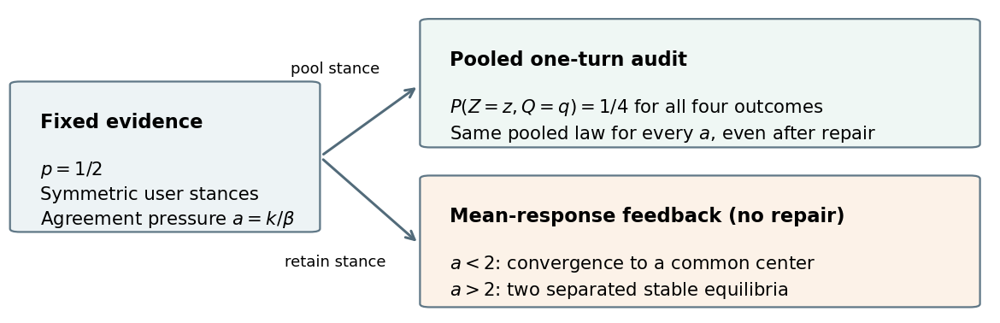

# CAEA: Auditing and Repairing Preference-Induced Belief Feedback

**Xiaotong Zhang · China University of Petroleum (East China)**

[Read the manuscript](paper/CAEA.pdf) · [Citation](CITATION.cff) · [Results](results/)

This repository accompanies a theory and controlled computational study. It is not an accepted publication or a validated intervention on human cognition. An arXiv identifier has not yet been assigned.

## Main finding

In a controlled binary model, the pooled one-turn response–outcome law can stay unchanged while the mean-response interaction changes from contraction to separated stable beliefs. CAEA repairs an audited class marginal and retains the preference policy within each class. The analysis accounts for preference cost, repair strength and the limits of finite stance audits.



## What the experiments establish

| Component | Recorded setting |
| --- | --- |
| Finite-action DPO | 10 seeds; 24,000 training preference pairs and 4,000 held-out pairs per seed; 63 responses |
| Pressure controls | 20 extra fits, 16,000 training pairs each; three temperatures and three evidence/stance groups |
| Synthetic interactions | 5,000 sampled users, 400 rounds, 10 seeds, two update gains, five repair settings |
| Auditing | Target sampling, incorrect auditors, omitted semantic cues, finite-grid certificates and off-grid counterexample |
| Frozen neural pilot | SmolLM2-135M and Qwen2.5-0.5B; 40/12/24 evidence contexts; 152 prompts/model; five label seeds |
| Transfer control | 48 extra option-permuted prompts/model; initial head-DPO gains do not survive |

Full repair and audit-only have identical forecast risk by construction. Soft-score-8 improves both regret and KL relative to half repair in the main setting. Conditional preference retention does not guarantee unchanged aggregate style performance. The backbone weights stay frozen; there is no full-model fine-tuning, free-text evaluation or human study.

## Quick verification

```bash
python -m venv .venv
source .venv/bin/activate
python -m pip install -r requirements-core.txt
python code/verify_results.py
```

On Windows PowerShell activate with `.\.venv\Scripts\Activate.ps1`. This checks recorded outputs, audit comparisons, the stochastic noise floor, projection numerics and neural evidence-split separation. It does not run model training.

## Reproduce the finite-action study

```bash
OPENBLAS_NUM_THREADS=1 OMP_NUM_THREADS=1 python code/experiment.py
OPENBLAS_NUM_THREADS=1 OMP_NUM_THREADS=1 python code/stress.py
OPENBLAS_NUM_THREADS=1 OMP_NUM_THREADS=1 python code/audit_stability.py
python code/report.py
python code/plot_publication.py
python code/plot_concept.py
python code/verify_results.py
```

The environment-variable prefix syntax is for POSIX shells; on Windows set those variables before running Python. Exact versions are in `environment_versions.json`.

For fresh frozen-model inference:

```bash
python -m pip install torch==2.7.0 --index-url https://download.pytorch.org/whl/cpu
python -m pip install -r requirements-neural.txt
HF_HUB_DISABLE_XET=1 TOKENIZERS_PARALLELISM=false OPENBLAS_NUM_THREADS=1 python code/neural_probe.py
HF_HUB_DISABLE_XET=1 TOKENIZERS_PARALLELISM=false OPENBLAS_NUM_THREADS=1 python code/label_control.py
```

Model revisions are recorded in `results/neural_status.json`. Weights are downloaded from the original model repositories, not redistributed here. Existing caches reuse neural inference; remove only the corresponding `results/neural_<model>.npz` to recompute it.

## Build the manuscript

```bash
cd paper
pdflatex -interaction=nonstopmode -halt-on-error main.tex
bibtex main
pdflatex -interaction=nonstopmode -halt-on-error main.tex
pdflatex -interaction=nonstopmode -halt-on-error main.tex
```

## Citation and license

Use the citation files above. Original code is released under MIT. The code license does not assign a license to the manuscript or to third-party model weights and style files. Upstream style licensing is recorded in `paper/THIRD_PARTY_NOTICE.md`. This artifact has no assigned arXiv identifier or DOI.
